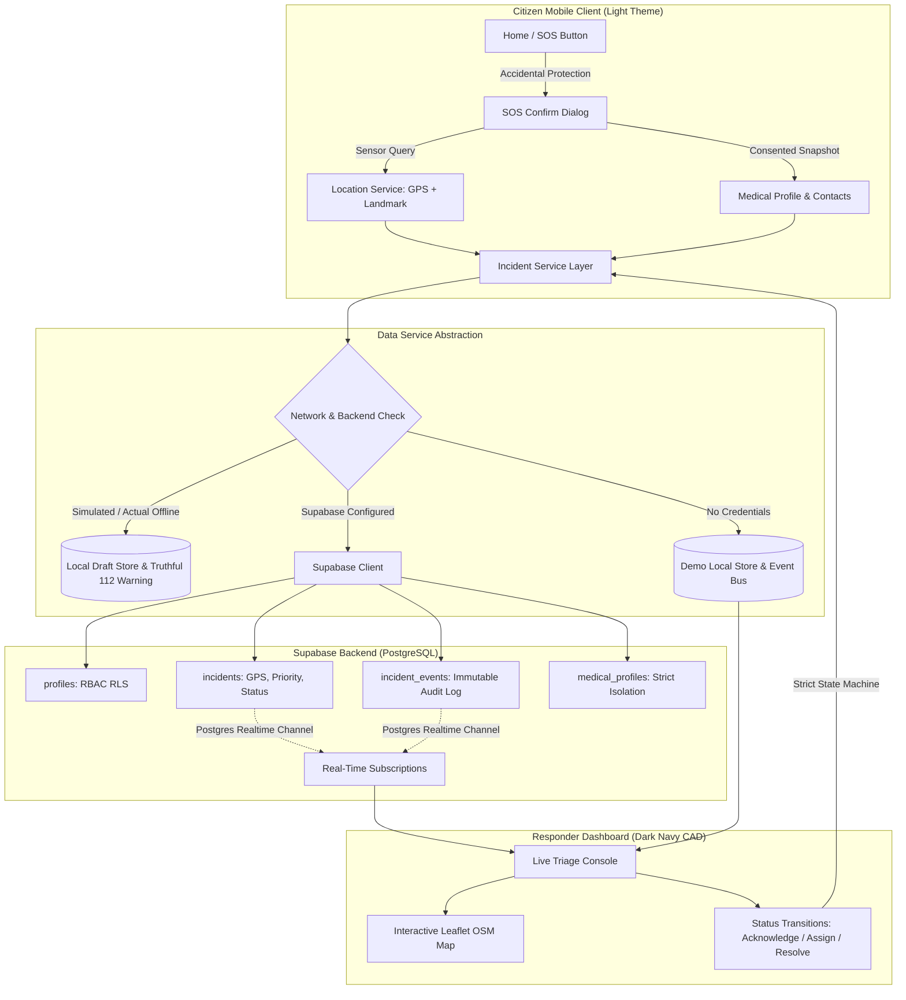

# PulseBridge — Emergency Response Coordination

> **BUILDATHON 2.0, KNEW-2K26**  
> **Problem Statement:** H4 — Emergency Health Assistance  
> **Theme:** Building intelligent solutions for a smarter, sustainable and secure tomorrow.

[](https://github.com/ShreehariSB/pulsebridge/actions/workflows/deploy.yml)
[](https://nodejs.org/)
[](LICENSE)

---

## 1. Project Overview & Problem Statement

In time-sensitive campus, industrial, and community health crises, victims often face severe bottlenecks: panicking users cannot convey accurate GPS coordinates indoors, bystanders lack access to crucial health contexts (such as severe drug allergies or asthma), and local response teams operate without unified computer-aided dispatch (CAD) triage.

**PulseBridge** is a modern, mobile-first emergency coordination platform that bridges this gap:
1. **Immediate Citizen SOS:** Large, single-tap SOS with accidental-activation prevention and a permanent direct hotline to India's official **112** emergency services.
2. **Telemetry & Landmarks:** Combines browser GPS sensors (with accuracy confidence metrics) and room/floor indoor landmark descriptions.
3. **Consented Health Snapshots:** Victims securely attach user-controlled, consented medical snapshots (blood group, allergies, medications) and emergency contacts.
4. **Authorized Responder Dashboard:** A tactical CAD console featuring real-time incident tracking, Leaflet interactive mapping, dispatcher acknowledgement, paramedic unit assignment, and immutable audit logs.
5. **Truthful Offline Resilience:** Detects network drops, preserves drafts locally, truthfully alerts the user that a remote dispatch could not be confirmed, and directs them to dial **112**.

> [!IMPORTANT]
> **Mandatory Prototype Disclosure:** PulseBridge is an engineering hackathon prototype developed for BUILDATHON 2.0. It coordinates local authorized responders and does **not** replace national public safety answering points (PSAPs) or municipal ambulances. In real life-threatening emergencies across India, always dial **112** immediately.

---

## 2. Technology Stack

- **Frontend:** React 19, TypeScript, Vite
- **Routing:** React Router v7 (`HashRouter` for zero-configuration, seamless static hosting on GitHub Pages)
- **Database & Realtime:** Supabase (PostgreSQL 15+, Row Level Security, Realtime Replication)
- **Mapping:** Leaflet & OpenStreetMap (`react-leaflet`, custom SVG marker pins)
- **Icons & Design System:** Lucide React, CSS variables, mobile-first responsive layout (Dark Navy theme for Responders, Clean Light theme for Citizens)
- **Testing:** Vitest, React Testing Library, `@testing-library/jest-dom`, JSDOM
- **CI/CD:** GitHub Actions deploying to GitHub Pages

---

## 3. Architecture & Data Flow



---

## 4. Key Features

| Feature | Citizen Experience | Responder / Dispatcher Experience |
| :--- | :--- | :--- |
| **Instant SOS** | 1-click SOS button with 3s cancel buffer to stop false alarms | Visual alert with critical priority badge and audio-visual cues |
| **Official Helpline** | Direct `tel:112` call button never blocked by login or AI | Direct caller phone link and escalation buttons |
| **Location Telemetry** | GPS coordinate fix + accuracy radius + indoor landmark fallback | Interactive Leaflet map with colored status pins & coordinates |
| **Medical Profile** | User-controlled blood group, allergies, medications, and consent toggle | Secure snapshot attached only to active incident for safe triage |
| **CAD State Machine** | Real-time status tracker (`SUBMITTED` &rarr; `ACKNOWLEDGED` &rarr; `ASSIGNED` &rarr; `RESOLVED`) | Strict role-based transitions with immutable audit history |
| **Resilience & Testing** | Truthful offline indicator with local draft preservation | Simulate network outage toggle to verify offline behavior |

---

## 5. Project Folder Structure

```
pulsebridge/
├── .github/
│   └── workflows/
│       └── deploy.yml              # Automated GitHub Pages CI/CD workflow
├── supabase/
│   └── migrations/
│       ├── 20261029000001_create_pulsebridge_schema.sql  # Tables, RLS, functions
│       └── 20261029000002_seed_demo_data.sql              # Fictional demo seed data
├── src/
│   ├── types/
│   │   └── index.ts               # Core TypeScript definitions and state enums
│   ├── services/
│   │   ├── supabase.ts            # Supabase client singleton & env validator
│   │   ├── incidentService.ts     # Data service abstraction (Supabase / Demo)
│   │   ├── demoData.ts            # Fictional incidents for instant demonstration
│   │   ├── locationService.ts     # Geolocation wrapper with fallback handling
│   │   └── medicalService.ts      # Consented medical profile storage
│   ├── context/
│   │   ├── AuthContext.tsx        # Auth state & demo persona switcher
│   │   └── IncidentContext.tsx    # Incident store, active incident & realtime sync
│   ├── components/
│   │   ├── common/
│   │   │   ├── Header.tsx         # Navbar, persona switcher, 112 button
│   │   │   ├── Footer.tsx         # Disclosures, helpline directory, copyright
│   │   │   ├── StatusBadge.tsx    # SUBMITTED, ACKNOWLEDGED, ASSIGNED, RESOLVED badges
│   │   │   └── DemoBanner.tsx     # Demo mode & offline outage simulation controls
│   │   ├── map/
│   │   │   └── IncidentMap.tsx    # Leaflet interactive OpenStreetMap component
│   │   └── incident/
│   │       ├── SOSConfirmDialog.tsx # Accidental activation protection dialog
│   │       └── IncidentTimeline.tsx # Timestamped audit trail
│   ├── pages/
│   │   ├── EmergencyHome.tsx      # Page A: Emergency Home & SOS
│   │   ├── CreateIncident.tsx     # Page B: Detailed incident reporting
│   │   ├── IncidentTracking.tsx   # Page C: Incident live status tracker
│   │   ├── ResponderDashboard.tsx # Page D: Tactical dispatch center & CAD
│   │   ├── MedicalProfilePage.tsx # Page E: Medical profile & emergency contacts
│   │   └── SettingsHelpPage.tsx   # Page F: Settings, help, disclosures & telemetry
│   ├── test/
│   │   ├── setup.ts               # Vitest environment setup
│   │   ├── transitions.test.ts    # State machine transition unit tests
│   │   ├── incidentService.test.ts# Incident CRUD & offline simulation tests
│   │   ├── locationService.test.ts# Geolocation fallback tests
│   │   └── components.test.tsx    # UI component & accessible 112 hotline tests
│   ├── App.tsx                    # Route definitions with HashRouter
│   ├── main.tsx                   # React root entrypoint
│   └── index.css                  # CSS variables, design system tokens & theme overrides
├── index.html                     # Mobile viewport, meta tags & favicon
├── vite.config.ts                 # Vite & Vitest configuration
├── tsconfig.json                  # TypeScript compiler configuration
├── .env.example                   # Environment variable template
└── README.md                      # Comprehensive project documentation
```

---

## 6. Local Installation & Development

### Prerequisites
- Node.js `v18.0.0` or later (`v20+` or `v24` recommended)
- npm `v9.0.0` or later
- Git

### Commands (Windows PowerShell)

```powershell
# 1. Clone the repository
git clone https://github.com/<your-username>/pulsebridge.git
cd pulsebridge

# 2. Install dependencies
npm install

# 3. Start local development server
npm run dev
```

Open your browser at `http://localhost:5173/` to view the application.

---

## 7. Environment Configuration

PulseBridge operates out-of-the-box in **Demo Mode** without external dependencies. To connect your live Supabase backend:

1. Copy `.env.example` to `.env.local`:
   ```powershell
   Copy-Item .env.example .env.local
   ```
2. Open `.env.local` and enter your project credentials:
   ```env
   VITE_SUPABASE_URL=https://xyzcompany.supabase.co
   VITE_SUPABASE_ANON_KEY=eyJhbGciOiJIUzI1NiIsInR5cCI...
   ```

> [!CAUTION]
> Never include your Supabase `service_role` key, database passwords, or secret credentials in frontend environment variables. Only the public anonymous key (`VITE_SUPABASE_ANON_KEY`) should be exposed to the client.

---

## 8. Supabase Backend Setup & Database Migrations

### Setting Up a New Supabase Project
1. Log in to [Supabase](https://supabase.com/) and click **New Project**.
2. Name your project `pulsebridge` and set a strong database password.
3. Open the **SQL Editor** from the left navigation.
4. Execute the migration file:
   - Copy contents of [20261029000001_create_pulsebridge_schema.sql](file:///C:/Users/Shree%20hari%20S%20B/.gemini/antigravity/scratch/pulsebridge/supabase/migrations/20261029000001_create_pulsebridge_schema.sql) and run it.
5. (Optional) Run the demo seed file:
   - Copy contents of [20261029000002_seed_demo_data.sql](file:///C:/Users/Shree%20hari%20S%20B/.gemini/antigravity/scratch/pulsebridge/supabase/migrations/20261029000002_seed_demo_data.sql) and run it.

### Provisioning Authorized Responder Accounts
To prevent unauthorized users from escalating their own privileges:
1. In the Supabase Dashboard, navigate to **Authentication** &rarr; **Users** and invite or create the responder's account (e.g. `responder@hospital.org`).
2. Open the **SQL Editor** and promote the user by executing:
   ```sql
   UPDATE public.profiles
   SET role = 'responder',
       badge_number = 'PB-DISPATCH-01',
       organization = 'City Medical Emergency Center'
   WHERE id = '<USER-UUID-FROM-AUTH>';
   ```
3. PostgreSQL Row Level Security (RLS) ensures that only users with `role IN ('responder', 'admin')` can update incident statuses or assign paramedics.

---

## 9. Demo Mode & Presentation Features

For hackathons, offline presentations, and evaluators without active database keys, PulseBridge features an integrated **Demo Suite**:

1. **Persona Switcher:** Select between *Citizen User (Aditya)*, *Dispatcher Sarah*, and *Lead Medic Dr. Vikram* from the top navigation bar to test citizen and responder perspectives.
2. **Offline Outage Simulation:** Click **Simulate Offline Drop** in the top banner. Notice that:
   - The connection indicator turns red (*Offline Mode*).
   - Creating an incident truthfully informs the user: *"Network unavailable. Incident saved as an offline draft. Please dial official emergency 112 immediately."*
   - The user is never misled into believing an unconfirmed alert was transmitted.
3. **Reset Demo Data:** Click **Reset Demo** in the banner at any time to restore fictional sample records.

---

## 10. Automated Testing

Run the automated test suite verifying form validation, state transitions, geolocation fallbacks, and component rendering:

```powershell
# Run Vitest tests once
npm run test:run

# Run Vitest in interactive watch mode
npm run test

# Run production build and TypeScript check
npm run build
```

---

## 11. GitHub Repository Setup & GitHub Pages Deployment

### Step 1: Initialize Git and Push to GitHub

```powershell
cd "C:\Users\Shree hari S B\.gemini\antigravity\scratch\pulsebridge"
git init
git add .
git commit -m "Initial release: PulseBridge Emergency Response Coordination (BUILDATHON 2.0)"
git branch -M main
git remote add origin https://github.com/<your-username>/pulsebridge.git
git push -u origin main
```

### Step 2: Configure GitHub Pages Settings
1. Go to your repository on GitHub: `https://github.com/<your-username>/pulsebridge/settings/pages`.
2. Under **Build and deployment** &rarr; **Source**, select **GitHub Actions**.
3. Push to `main` branch or trigger the workflow manually under the **Actions** tab.
4. The workflow will run tests, build the application with base path `/pulsebridge/`, and deploy to:
   `https://<your-username>.github.io/pulsebridge/`

### Step 3: Optional Supabase Secrets in GitHub Actions
If you wish to build with your live Supabase database connected on GitHub Pages:
1. Go to **Settings** &rarr; **Secrets and variables** &rarr; **Actions** &rarr; **Variables**.
2. Add:
   - `VITE_SUPABASE_URL`: Your Supabase project URL.
   - `VITE_SUPABASE_ANON_KEY`: Your Supabase anonymous public key.
3. Re-run the deploy workflow.

---

## 12. Security, Privacy & Compliance

- **Principle of Least Privilege:** Medical profiles are kept strictly isolated. Responders only view an immutable snapshot consented at the time of incident creation.
- **Row Level Security (RLS):** All Supabase tables have RLS policies enabled. Unauthenticated users cannot read private medical records.
- **Truthful Status Reporting:** PulseBridge never claims SMS or WhatsApp messages have been sent without a configured and verified gateway.
- **Parametric Database Operations:** All queries use Supabase's parameterized SDK, preventing SQL injection vulnerabilities.
- **Accessible Touch Targets:** Buttons meet WCAG 2.1 AA 48px touch targets for rapid, high-stress interaction.

---

## 13. Hackathon Demo Presentation Checklist (5-Minute Walkthrough)

1. **Step 1: Emergency Citizen Portal (`#/`)**
   - Show the prominent SOS button with pulse animation.
   - Point out the **Call 112** instant shortcut that works without logging in.
2. **Step 2: Geolocation & Accidental Activation Prevention**
   - Click the SOS button.
   - Demonstrate the **3-second confirmation dialog** showing acquired GPS coordinates and consented medical summary.
3. **Step 3: Incident Creation & Tracking (`#/tracking`)**
   - Confirm the SOS.
   - Show the generated human-readable reference ID (e.g. `PB-7K9M2W`).
   - View the confirmed backend receipt and interactive Leaflet map pin.
4. **Step 4: Tactical Responder CAD Console (`#/responder`)**
   - Switch persona to *Dispatcher Sarah* in the header.
   - Navigate to the Responder Center (Dark Navy theme).
   - Observe live metrics update: Unacknowledged counter increases.
5. **Step 5: Triage & Unit Assignment**
   - Click the incident in the dispatch list.
   - Click **Acknowledge Incident** &rarr; notice timestamped CAD event recorded.
   - Click **Assign Dispatch Unit** &rarr; assign `Paramedic Team Alpha (Unit 4)`.
6. **Step 6: Citizen View Synchronized**
   - Navigate back to `#/tracking` &rarr; observe status has dynamically updated to `ASSIGNED` with dispatcher notes.
7. **Step 7: Truthful Offline Outage Test**
   - Click **Simulate Offline Drop** in the top banner.
   - Create a new incident &rarr; observe that the system truthfully alerts the user that network transmission failed, preserves the draft locally, and directs them to 112.
8. **Step 8: Resolution & Medical Handover**
   - In the responder center, mark the incident as `RESOLVED` with handover notes.

---

## 14. Team & Hackathon Attribution

- **Hackathon:** BUILDATHON 2.0, KNEW-2K26
- **Problem Statement:** H4 — Emergency Health Assistance
- **Theme:** Building intelligent solutions for a smarter, sustainable and secure tomorrow.
- **Project Name:** PulseBridge — Emergency Response Coordination
- **Repository:** [https://github.com/ShreehariSB/pulsebridge](https://github.com/ShreehariSB/pulsebridge)

*PulseBridge — Connecting citizens in crisis with immediate, intelligent assistance.*
